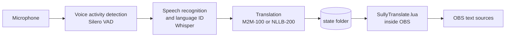

# SullyTranslate

Live translated subtitles for OBS Studio. Speak into your microphone in one language and SullyTranslate shows
what you said, translated, as a text source on your stream, within about a second of you finishing a sentence.

Everything runs on your own PC: no accounts, no API keys, no cloud service, and your voice never leaves the
machine. An NVIDIA graphics card is used when present; otherwise it runs on the CPU.

- Detects the spoken language automatically, or only listens for the languages you choose (for example Slovak
  and English, ignoring everything else)
- Translates into 98 languages
- Shows words live while you are still talking, then the corrected sentence when you finish
- Captions are ordinary OBS text sources: move, resize, crop, and filter them like anything else in your scene
- Font, size, colors, gradient, outline, background box, alignment, and how long each line stays on screen are
  all set from inside OBS

## Contents

- [Requirements](#requirements)
- [Installation on Windows](#installation-on-windows)
- [Installation on Linux](#installation-on-linux)
- [First-time setup in OBS](#first-time-setup-in-obs)
- [Settings](#settings)
- [How it works](#how-it-works)
- [Translation models and licensing](#translation-models-and-licensing)
- [Performance](#performance)
- [Troubleshooting](#troubleshooting)
- [Updating](#updating)
- [Uninstalling](#uninstalling)
- [Command-line use](#command-line-use)
- [License](#license)

## Requirements

| | Minimum | Recommended |
|---|---|---|
| Operating system | Windows 10 or 11 (64-bit), or Linux with PipeWire or PulseAudio | Windows 11 |
| OBS Studio | 30 or newer | latest |
| Graphics card | none (runs on the CPU, slower) | NVIDIA GPU with 6 GB of video memory or more |
| Disk space | 6 GB | 10 GB |
| Internet | only during installation (downloads Python, libraries, and models) | |

No Python installation is needed: the installer downloads its own private copy.

Tested on Linux with OBS 32 and an NVIDIA RTX 3090 Ti. The Windows version uses the same engine and OBS script
with Windows audio capture and text sources; please report anything that does not work on Windows (see
[Getting help](#getting-help)).

## Installation on Windows

1. **Download** this repository: on the GitHub page click **Code**, then **Download ZIP**.
2. **Extract** the ZIP anywhere (for example your Downloads folder). If Windows marks the files as downloaded
   from the internet, right-click the ZIP before extracting, choose **Properties**, tick **Unblock**, and click OK.
3. **Close OBS** if it is open.
4. **Double-click `install.bat`.** If Windows shows "Windows protected your PC", click **More info**, then
   **Run anyway**.
5. Wait for the installer to finish. It takes 5 to 15 minutes depending on your connection, because the speech
   and translation models are several gigabytes. When it prints **Done!**, press a key to close the window.
6. **Start OBS.** Two text sources, `SullyTranslate: translation` and `SullyTranslate: original`, are added to
   your current scene, and the speech engine starts automatically in the background.

The installer puts everything in `%LOCALAPPDATA%\SullyTranslate` (or `C:\SullyTranslate` if your Windows user
name contains non-English characters, which OBS scripts cannot handle). It does not need administrator rights
and does not change any system settings.

What the installer does, in order:

1. Copies SullyTranslate into the install folder
2. Downloads [uv](https://github.com/astral-sh/uv), a small tool that installs a private Python 3.12
3. Installs the speech and translation libraries, plus NVIDIA CUDA libraries if an NVIDIA card is found
4. Downloads the models
5. Adds `SullyTranslate.lua` to OBS (Tools > Scripts), keeping a backup of your scene collection

## Installation on Linux

Requirements: OBS installed from your distribution's packages (the Flatpak version of OBS cannot start
programs outside its sandbox), PipeWire or PulseAudio (`pactl` and `parec`), `curl`, and `tar`.

```bash
git clone https://github.com/SuIIiven/SullyTranslate.git
cd SullyTranslate
./install.sh                # installs into ~/.local/share/SullyTranslate
```

Close OBS when the installer asks. Pass a folder to install somewhere else: `./install.sh ~/apps/SullyTranslate`.

## First-time setup in OBS

1. Open **Tools > Scripts** and select **SullyTranslate.lua** in the list.
2. Check the **Status** line at the top. It should say `listening: <your microphone>`. On the very first start
   it says `loading models` for up to a minute.
3. Under **Speech**:
   - Choose your **Microphone** (or keep "Default microphone").
   - Tick the **languages you speak**. Speech in any other language is ignored. Tick nothing to detect any
     language.
   - Choose **Translate into**.
   - Optionally enter **Words to prefer**: your name, game titles, slang you use. This noticeably improves
     recognition of unusual words.
4. Under **Style**, pick a font, size, and colors. Changes appear on stream immediately.
5. Close the Scripts window and position the `SullyTranslate: translation` source in your scene. Turn on
   **Also show what was said** if you want the original sentence in the second source as well.

Speak a sentence: the translation appears in the text source and disappears after the hold time.

## Settings

All settings are in **Tools > Scripts > SullyTranslate.lua** and are saved with your OBS scene collection.

### Speech

| Setting | What it does |
|---|---|
| Microphone | Input device to listen to. Independent of OBS's own audio sources. |
| Languages you speak | Only speech detected as one of these languages is subtitled. None ticked = any language. |
| Other languages | Languages without a checkbox, as names or codes separated by commas, for example `Swedish, fi`. |
| Translate into | Output language. Lines already in this language are shown as spoken. |
| Words to prefer | Names and terms the speech recognizer should favor. |
| Speech model | `large-v3` is the most accurate; `large-v3-turbo` is about twice as fast. Auto picks `large-v3` on an NVIDIA GPU and `large-v3-turbo` on the CPU. |
| Translation model | See [Translation models and licensing](#translation-models-and-licensing). |
| Run on | Auto uses an NVIDIA GPU when one is found and falls back to the CPU if the GPU cannot be used. |

Changing the microphone, a model, or "Run on" restarts the engine automatically (a few seconds). Everything
else applies instantly.

### Captions

| Setting | What it does |
|---|---|
| Hold finished line | Seconds a finished sentence stays on screen. 0 keeps it until the next sentence. |
| Show words live while speaking | Updates the caption about once per second while you talk. Turn off to show only finished sentences. |
| Also show what was said | Puts the original sentence in the `SullyTranslate: original` source. |
| Wrap width | Line width in pixels before the text wraps. 0 keeps everything on one line. |

### Style

| Setting | What it does |
|---|---|
| Font | Typeface, style, and size of the translation. |
| Text color, Gradient, Gradient color | Solid color or a top-to-bottom gradient. |
| Outline | Outline around the letters. On Windows, size and color are adjustable. |
| Background box (Windows) | Colored box behind the text, with adjustable opacity. |
| Alignment (Windows) | Left, center, or right alignment inside the wrap width. |
| Drop shadow (Linux) | Shadow behind the text. |
| Original text size and color | Look of the `SullyTranslate: original` source. |

### Buttons

| Button | What it does |
|---|---|
| Refresh status / microphones | Re-reads the status line and the microphone list. |
| Add caption sources to the current scene | Adds the two sources to the scene you are viewing (for example after switching scenes or deleting them). |
| Restart engine | Restarts speech recognition and translation. |

## How it works



SullyTranslate has two parts:

- **The engine** (`sullytranslate.py`) runs in the background as its own process. It listens to the
  microphone, uses a voice detector to find where sentences start and end, recognizes the speech and its
  language with Whisper (via [faster-whisper](https://github.com/SYSTRAN/faster-whisper)), and translates it
  with [CTranslate2](https://github.com/OpenNMT/CTranslate2). While you speak it re-transcribes the sentence
  about once per second for the live caption; when you pause it runs a slower, more accurate final pass.
- **The OBS script** (`SullyTranslate.lua`) is the part you see. It provides the settings, creates the text
  sources, starts the engine when OBS starts and stops it when OBS closes, and copies each new caption into
  the text sources.

The two communicate through small files in the `state` folder of the install directory. No network port is
opened. The script writes the settings and a once-per-second heartbeat; the engine writes the current caption,
the text style, and the list of microphones. If OBS closes or crashes, the engine notices the missing heartbeat
and exits within ten seconds. If the engine crashes, the script restarts it within about half a minute.

OBS's built-in Lua scripting is used instead of Python scripting so that nothing has to be configured inside
OBS.

## Translation models and licensing

| Model | Quality | Speed | License | Commercial use |
|---|---|---|---|---|
| M2M-100 1.2B (default on GPU) | good | fast | MIT | allowed |
| M2M-100 418M (default on CPU) | fair | fastest | MIT | allowed |
| NLLB-200 3.3B | best | fast on GPU | CC-BY-NC 4.0 | **not allowed** |
| NLLB-200 1.3B | very good | faster | CC-BY-NC 4.0 | **not allowed** |

NLLB-200 translates more naturally, but Meta released it for non-commercial use only. If your stream earns
money (subscriptions, ads, donations, sponsorships), that is likely commercial use; keep the default M2M-100
models in that case. The choice is yours; this is not legal advice.

The speech recognizer (OpenAI Whisper) and the voice detector (Silero VAD) are MIT-licensed.

Models are downloaded once, during installation or the first time you pick a different one, into the `models`
folder of the install directory.

## Performance

Measured on an NVIDIA RTX 3090 Ti with the default models (`large-v3` and M2M-100 1.2B):

| | Time |
|---|---|
| Live caption updates while speaking | about every 1 second |
| Finished, translated sentence after you stop speaking | about 0.6 seconds |
| Engine start (models already downloaded) | a few seconds, up to about 20 seconds from a cold disk |

Video memory use is about 5.6 GB. On GPUs with less memory, choose `large-v3-turbo` and M2M-100 418M. Without
an NVIDIA GPU everything runs on the CPU with smaller models; expect captions to arrive noticeably later than
on a GPU.

## Troubleshooting

Start with the **Status** line in Tools > Scripts > SullyTranslate.lua (click **Refresh status**). Detailed
logs are in two places:

- Engine log: `state\engine.log` in the install folder (`%LOCALAPPDATA%\SullyTranslate\state\engine.log` on
  Windows)
- OBS script log: Tools > Scripts > **Script Log**

| Problem | What to do |
|---|---|
| Status says `engine not installed` | Run `install.bat` again. The script must stay in the install folder. |
| Status stays at `loading models` | First start after installing a new model can take a few minutes. Check `engine.log` for download errors. |
| Status starts with `error:` | Read the message and the end of `engine.log`. Often the selected microphone was unplugged: choose another one. |
| No captions, status says `listening` | Check the right microphone is selected. Untick all languages to rule out language filtering. Speak a full sentence and pause. |
| Captions appear in the wrong scene or are missing | Click **Add caption sources to the current scene**. |
| Some sentences are skipped | They were detected as a language you did not tick. Similar languages (for example Slovak and Czech) can be confused on short sentences: tick both. |
| Words are misrecognized | Add them to **Words to prefer**. Use `large-v3` rather than turbo. |
| Captions lag behind speech | Check the status line says `GPU`. If it says `CPU`, update your NVIDIA driver and choose "Run on: NVIDIA GPU". Otherwise choose smaller models. |
| Installer says OBS is running | Close OBS completely (also from the system tray) and press Enter. |
| Installer cannot find a scene collection | Start OBS once, close it, and run the installer again. Or add the script yourself: Tools > Scripts > `+` > `SullyTranslate.lua` in the install folder. |
| Windows blocks `install.bat` | Unblock the ZIP before extracting (see step 2), or click More info > Run anyway. |

### Getting help

Open an issue on the repository's **Issues** page and include:

1. What you expected and what happened
2. The status line text
3. `state\engine.log` from the install folder
4. Your Windows (or Linux distribution) version, OBS version, and graphics card

## Updating

Download the new version, extract it, and run `install.bat` (or `./install.sh`) again. Your OBS settings and
already-downloaded models are kept.

## Uninstalling

1. Close OBS.
2. Remove the script from OBS: in the install folder run
   `.venv\Scripts\python.exe setup_obs.py --remove SullyTranslate.lua` (Linux:
   `.venv/bin/python setup_obs.py --remove SullyTranslate.lua`), or in OBS open Tools > Scripts, select
   SullyTranslate.lua, and click the `-` button.
3. Delete the two `SullyTranslate:` text sources from your scenes.
4. Delete the install folder. This removes the private Python, the libraries, and the models.

## Command-line use

The engine also works without OBS. From the install folder:

```bash
# Overlay window with live translation and a scrollable history
# (Linux: captures what plays on your speakers; Windows: your default microphone)
.venv/bin/python sullytranslate.py -l sk en

# Print translations in the terminal instead
.venv/bin/python sullytranslate.py --cli -l sk en -t en

# List audio inputs, then capture a specific one
.venv/bin/python sullytranslate.py --list-inputs
.venv/bin/python sullytranslate.py -s <id from the list>
```

On Windows use `.venv\Scripts\python.exe` instead of `.venv/bin/python`. Run with `--help` for all options.

## License

SullyTranslate is released under the [MIT License](LICENSE). The models it downloads have their own licenses;
see [Translation models and licensing](#translation-models-and-licensing).
